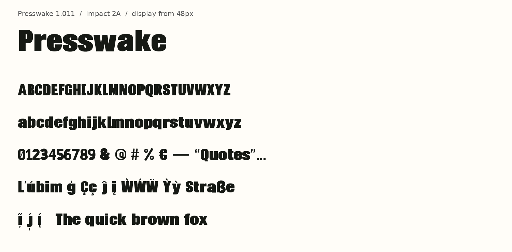

# Presswake · Condensed editorial force

An ultraheavy condensed display sans with blunt terminals, compact lowercase and tightly held counters. Built for short editorial headlines, campaign titles and loud web typography.

## Story and inspiration

Impact inspired the dense advertising mass. The selected 2A raster after the missing-F edit develops that pressure into contemporary editorial lettering. Protected tracing and optical spacing retain the selected alphabet, while authored symbols, Latin composites and mark positioning extend its use. Package v5 restores the dot on ordinary į and reserves its dotless form for above-accent contexts.

Historical inspiration: **Impact**, selection **2A**. This is independent new artwork, not an official revival or an endorsed product. Openai raster followed by documented tracing and cleanup. Authored extensions and same-family composites are documented in the full production package; no commercial font software is bundled.

## Use the exact final fonts

- Desktop font: [`Presswake-Regular-v1.011.ttf`](fonts/Presswake-Regular-v1.011.ttf).
- Web font: [`Presswake-Regular-v1.011.woff2`](fonts/Presswake-Regular-v1.011.woff2) and [font.css](font.css).
- Open [specimen.html](specimen.html) for a live final-WOFF2 specimen and complete inventory.
- Version **1.011**, **354 mappings**: the full 354-codepoint union. [coverage.csv](coverage.csv) lists names, glyphs and advances from the actual TTF.
- Display minimum **48px**; use sufficient line height. These are static Regular display fonts.

## Provenance, construction and validation

[provenance.json](provenance.json) records the exact local final package, source path/hash, manifest verification and pinned production commit. [metadata.json](metadata.json) binds both final font hashes. The integrated fonts are byte-identical copies; no rebuilding or outline editing was done for integration. `preview.png` is a fresh actual-TTF raster at its recorded sizes; `specimen.html` loads the supplied WOFF2. Neither is a concept/A/B/C review image.

The final 354-scalar assembly includes an explicit fontTools artifact step after the compiler-valid ordinary source. A full final-assembly stock CLI preflight/release pass is not claimed. Producer source-stage checks and final-binary validation remain separate.

The full editable sources, original artwork, tracing/native-vector decisions, authored extension records, compatibility scripts and complete proofs remain in the named local production package. This compact sample is an artifact-use example, not a self-contained source-rebuild fixture. Read [the preserved production notes](provenance/production-notes.txt) for the package's reproduction entry point and evidence scope. Those notes describe the production handoff at that time; the present integration is separately authorized. Rebuild only into a fresh directory using its pinned environment and recheck any new bytes. Do not substitute an older intermediate from the package.

Run `python scripts/verify_modernized_samples.py` from the repository root with existing Fontify dependencies. It validates hashes, exact coverage including extras, all TTF/WOFF2 outlines and metrics, layout-table equivalence, real canonical/mixed shaping and whitespace semantics. This integration check is separate from producer source-stage gates and from human aesthetic approval.

## Bounded limitations

- Display use from 48px; body text and smaller sizes are not certified.
- Exact listed coverage and documented language/one- or two-mark samples only. Arbitrary accent stacks, every Latin orthography and every rendering engine are not certified.
- Static Regular TTF/WOFF2 only; no CFF OTF, variable axes or additional styles.
- No language-specific Lithuanian locale override is certified.

## Review and distribution status

Current final package cleared in integration handoff. Final human aesthetic approval remains pending. Source provenance and distribution terms need owner review. No new MIT license is assigned to these font assets; the repository's existing compiler/code license is unchanged. Local integration does not authorize upload, publication or redistribution. No generation, paid call, installation or credential creation was performed here.
